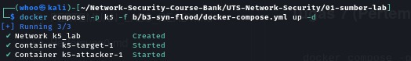
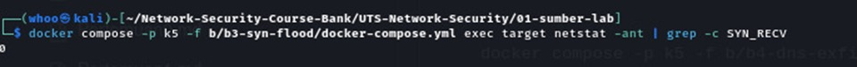
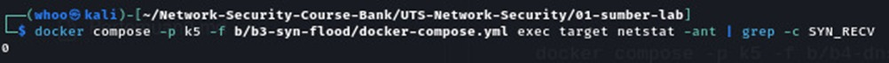
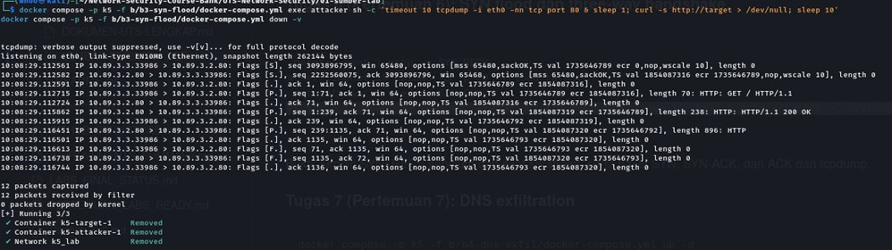
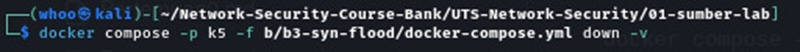

# SYN Flood — Kasus 5

**Pertemuan:** 6

## Tujuan
Pengamatan koneksi TCP/SYN pada target lab terisolasi dan analisis paket.

## Langkah dan dokumentasi
1. Buka terminal Kali Linux dan masuk ke direktori sumber lab yang sesuai.
2. Jalankan perintah sesuai lembar instruksi Kasus 5 dan file Compose/script pada repository.
3. Periksa keluaran perintah untuk memastikan pengujian berjalan pada lingkungan lab yang ditentukan.
4. Simpan bukti terminal pada folder `screenshot/`.

## Bukti screenshot

### Bukti 1

### Bukti 2

### Bukti 3

### Bukti 4

### Bukti 5

### Bukti 6

## Hasil dan kesimpulan

> Lengkapi bagian ini dengan hasil pengamatan aktual dari praktikum. Pastikan alamat IP, hash, status, password hasil uji, atau keluaran lain ditulis sesuai bukti yang benar-benar diperoleh.

## Catatan

- Jalankan seluruh pengujian hanya pada jaringan/container lab yang disediakan untuk praktikum.
- Jangan unggah token, private key, password akun, atau file bukti yang memuat data sensitif.
